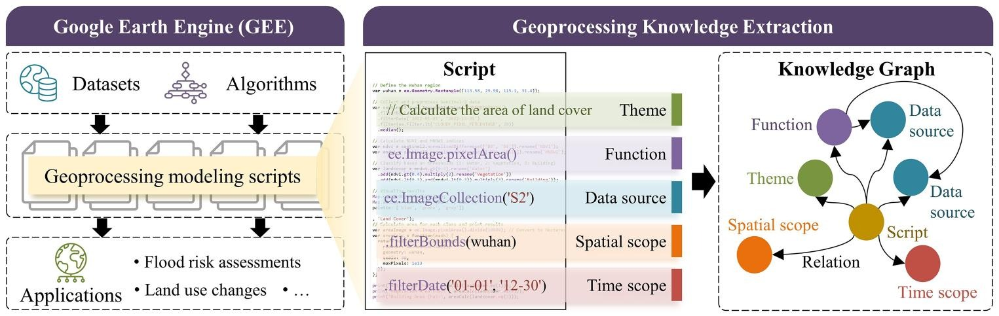

网络上共享的大量 Google Earth Engine 脚本包含了地理空间分析的实践知识，涵盖数据选择、云掩膜、指数计算到结果导出等环节。这些知识分散在代码中，难以复用。

*从脚本中抽取主题、功能、数据源以及时空范围，构建知识图谱。*

Geo-CLASS 协同大语言模型与小语言模型。在领域模式与模式感知的思维链提示引导下，由大语言模型识别脚本中的实体与关系；再由小语言模型通过语义向量化、余弦相似度与最佳匹配，将自由文本描述映射到地学知识库（GCMD、GeoNames、GEE 数据目录与功能词典），使不同脚本中含义相同、表述不同的描述统一为标准化实体。

在从 295,943 个脚本中选取的 237 个脚本上，相较 Llama-3、GPT-3.5 和 GPT-4o 等大语言模型基线，实体与关系识别准确率分别最多提升 31.9% 和 12.0%。

页首为 Geo-CLASS 框架总览图。图片引自 Zhao et al. (2026), *International Journal of Geographical Information Science*, 40(3), 808–841, [doi:10.1080/13658816.2025.2577252](https://doi.org/10.1080/13658816.2025.2577252)。
